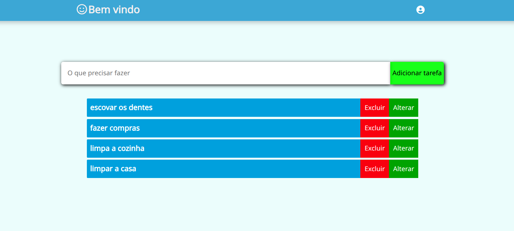
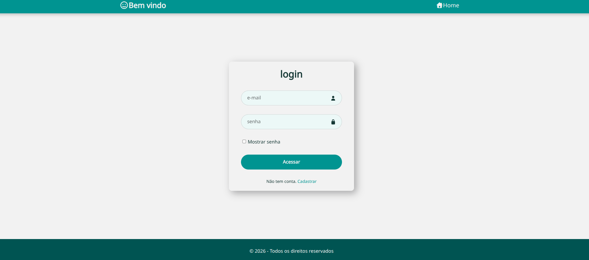
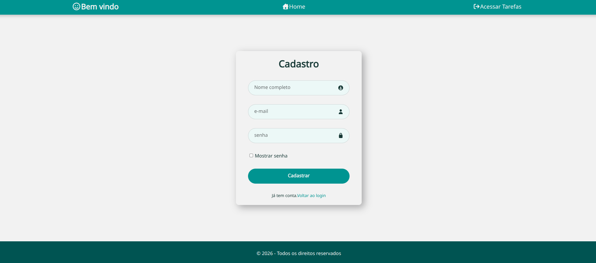
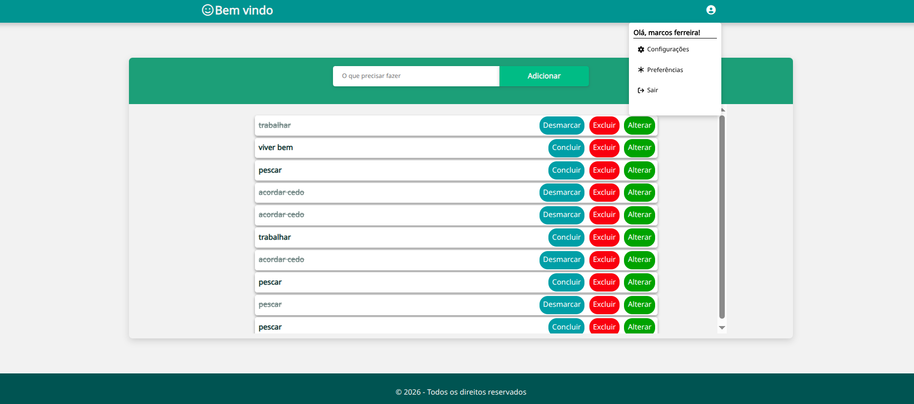
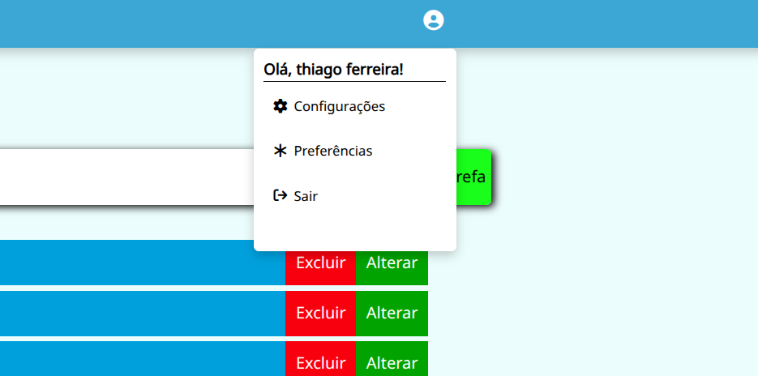

# 📝 TaskManager - Full Stack Todo List

Uma aplicação completa de gerenciamento de tarefas com sistema de autenticação, sessões de usuário e operações CRUD (Create, Read, Update, Delete) personalizadas para cada perfil.
<div align="center">

</div>

## 🚀 Tecnologias Utilizadas

### Frontend:
*   **HTML5 & CSS3**: Estrutura e estilização moderna.
*   **JavaScript (ES6+)**: Lógica de interface e consumo de API.
*   **Font Awesome**: Ícones interativos.
*   **Módulos JS**: Organização de alertas e feedbacks customizados.

### Backend:
*   **Node.js**: Ambiente de execução.
*   **Express**: Framework para criação de rotas e middlewares.
*   **Express-Session**: Gerenciamento de sessões e autenticação.
*   **Bcrypt**: Criptografia de senhas no banco.
*   **Dotenv**: Gerenciamento de variáveis de ambiente.
*   **MySQL**: Banco de dados relacional para persistência de dados.

## 🏗️ Arquitetura do Projeto (MVC)

O projeto foi organizado seguindo padrões de mercado para facilitar a manutenção:

```text
/project
├── /config         # Conexão com DB e leitura do .env
├── /controllers    # Lógica (Processamento, Criptografia e CRUD)
├── /middlewares    # Porteiro (Trava de autenticação)
├── /public         # Frontend Estático
│   ├── /css        # Estilos do projeto
|   ├── /html       # parte visual do projeto   
│   └── /js         # Lógica do navegador e alertas
├── /routes         # Endpoints da aplicação
├── .env            # Variáveis sensíveis (não enviado ao GitHub)
└── server.js       # Inicialização do servidor

```

## ✨ Funcionalidades

- [x] **Cadastro de Usuários**: Validação e armazenamento no banco de dados.
- [x] **Bcrypt: Hashing de senhas**: Para armazenamento seguro de senhas.
- [x] **Dotenv**: Gerenciamento de variáveis de ambiente (segurança de credenciais)
- [x] **Login com Sessão**: Autenticação segura via Express-Session.
- [x] **Proteção de Rotas (Porteiro)**: Apenas usuários logados acessam suas listas.
- [x] **CRUD de Tarefas**:
    - Criar novas tarefas.
    - Listar tarefas vinculadas apenas ao usuário logado.
    - Alterar descrição de tarefas existentes.
    - Excluir tarefas.
- [x] **Sistema de Notificações**: Alertas visuais para sucesso, erro e avisos (Login/Logout).
- [x] **Segurança**: Visualização de senha no login e logout completo da sessão.

## ✨ Visualizando o login
<div align="center">

</div>

## ✨ Visualizando o cadastro
<div align="center">

</div>

## ✨ Visualizando os listas
<div align="center">

</div>

## ✨ Visualizando o menu de saida
<div align="center">

</div>


## 🛠️ Como rodar o projeto

1.  **Clone o repositório:**
    ```bash
    git clone https://github.com/thiyaggo/todo-list-mysql-express.git
    ```

2.  **Instale as dependências:**
    ```bash
    npm install bcryptjs dotenv express express-session mysql2
    ```

3.  **Configure o Banco de Dados:**
    - Crie um banco de dados MySQL.
    - Execute as queries de criação de tabelas (fornecidas no arquivo `database.sql` se houver).
    - Configure suas credenciais no arquivo dentro da pasta `/config`.

4.  **Inicie o servidor:**
    ```bash
    npm start
    ```
    O servidor estará rodando em: `http://localhost:3000`

## ✉️ Contato

Desenvolvido por **[Thiago Ferreira]** – [https://www.linkedin.com/in/thiago-ferreira-desenvolvedor/]
